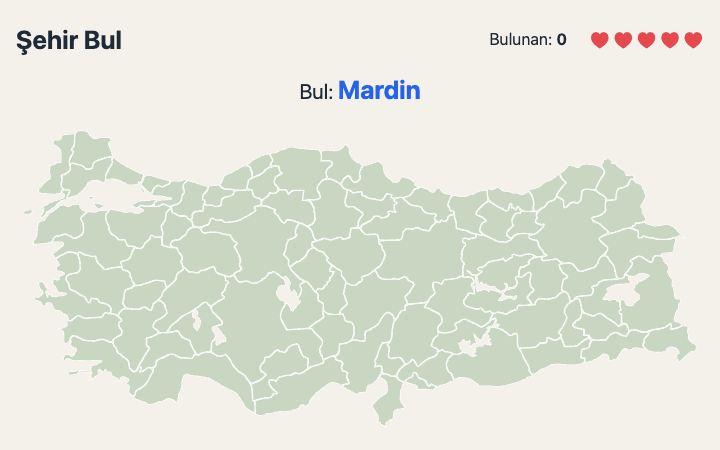

[English](README.md) · **Türkçe**

# Şehir Bul

Türkiye il haritası tahmin oyunu: oyun bir il adı yazar, sen haritada bulursun.
Doğru il yeşil, yanlış il kırmızı olur; toplam 5 hakkın var.

**🎮 Oyna: https://muhammedozkul.github.io/sehir-bul/**

<p align="center"></p>

## Bilgisayarında çalıştırmak

```sh
npm install
npm run dev
```

Vite + TypeScript ile yazıldı, framework kullanılmadı. `main` dalına her push'ta
GitHub Actions oyunu derleyip GitHub Pages'e yayınlar.
